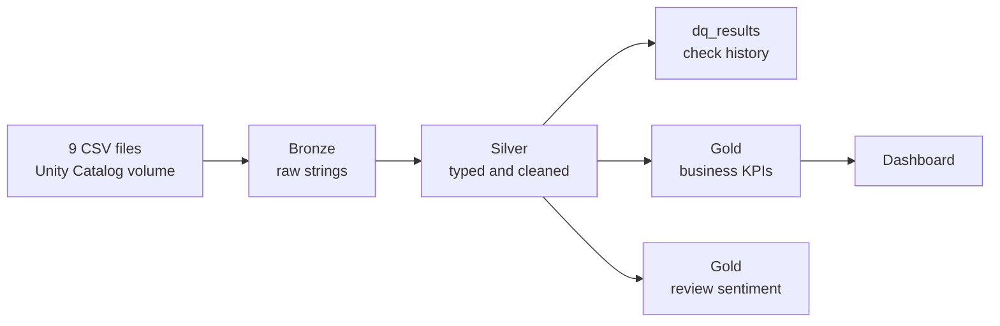
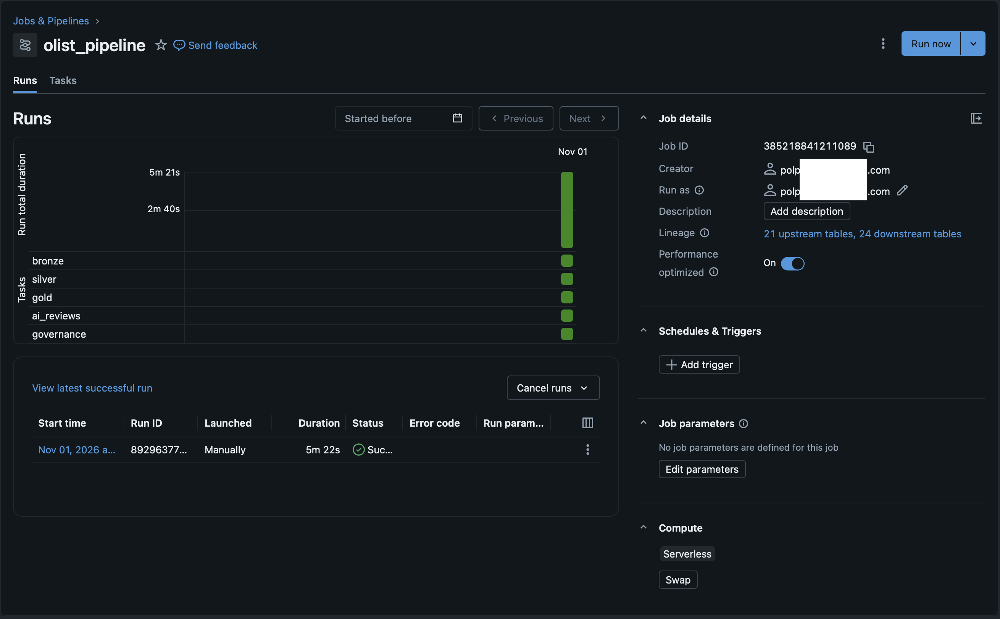
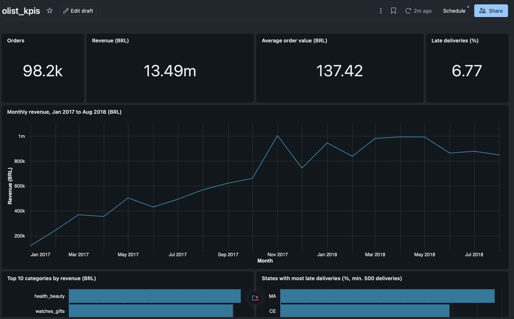
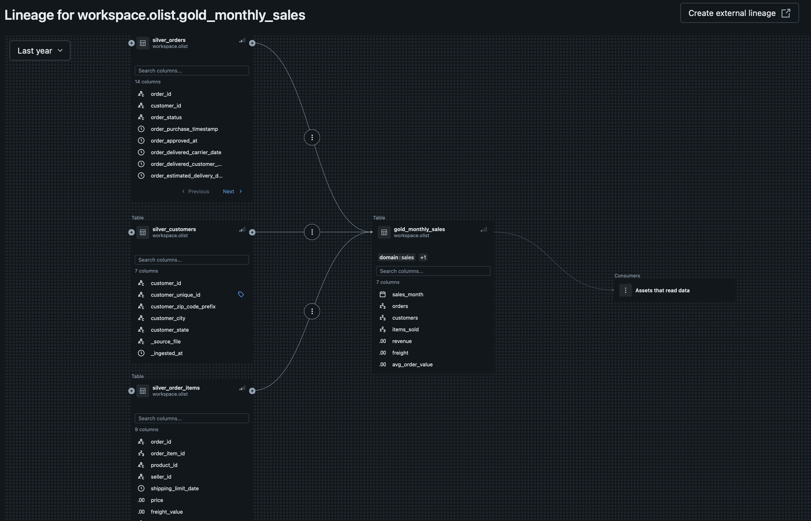

# Olist Lakehouse

An end-to-end data pipeline on Databricks. It turns the raw [Olist Brazilian e-commerce dataset](https://www.kaggle.com/datasets/olistbr/brazilian-ecommerce) into documented, quality-checked tables and business KPIs.

**Stack:** Databricks, Unity Catalog, Delta Lake, PySpark, SQL, Databricks AI Functions, pandas

## Architecture



A Databricks Job runs the notebooks in this order:

| Step | Notebook | What it does |
|---|---|---|
| 1 | [`01_bronze.py`](notebooks/01_bronze.py) | Loads the CSVs into Delta tables and records each row's source file and load time |
| 2 | [`02_silver.py`](notebooks/02_silver.py) | Sets types, cleans the data and runs the quality checks |
| 3 | [`03_gold.sql`](notebooks/03_gold.sql) | Builds the KPI tables and reconciles revenue across them |
| 4 | [`05_ai_reviews.sql`](notebooks/05_ai_reviews.sql) | Classifies the sentiment of a sample of review comments |
| 5 | [`04_governance.sql`](notebooks/04_governance.sql) | Adds table and column descriptions and tags in Unity Catalog |

Governance runs last because rebuilding a table can remove its comments.



## Data quality

Every silver run records 32 checks in the `dq_results` table:

- **26 `error` checks** stop the pipeline: unique and non-null primary keys, relationships between tables, and business rules such as positive prices.
- **6 `warning` checks** only record suspicious rows, which stay in the tables marked with a `dq_*` column, so each KPI can decide whether to exclude them.

Issues found in the source data:

| Issue | Rows | Treatment |
|---|---|---|
| Exact duplicates in geolocation | 261,831 | Removed |
| Coordinates outside Brazil, after removing duplicates | 33 | Removed |
| Carrier received the order before its approval | 1,359 | Marked |
| Delivered to the customer before the carrier date | 23 | Marked; excluded from delivery KPIs |
| Status `delivered` without a delivery date | 8 | Marked |
| Delivery date without status `delivered` | 6 | Marked |
| Payment value of zero or less | 9 | Marked |
| Payment type `not_defined` | 3 | Marked |

## Results

Gold tables reconcile to the same revenue, and the KPIs below match a separate calculation in pandas.

| KPI | Value |
|---|---|
| Orders | 98,199 |
| Revenue, excluding freight | R$ 13,494,400.74 |
| Average order value | R$ 137.42 |
| Late deliveries | 6.77% |
| Highest-revenue month | November 2017 (R$ 1,003,862.14) |
| Highest-revenue category | `health_beauty` (R$ 1,255,695.13) |

The first and last months of the dataset have very few orders, so the monthly chart covers January 2017 to August 2018.



## Review sentiment

`ai_analyze_sentiment` classifies a fixed sample of 1,000 comments, without training a model. Its output is compared with the score the customer gave:

| Customer score | Comments | Agreement |
|---|---|---|
| 1 to 2 stars | 253 | 87.0% classified as negative |
| 4 to 5 stars | 664 | 84.8% classified as positive |

This measures agreement with the score, not model accuracy: a customer can give a high score and still write a complaint. The sample is taken in `review_id` order, so it is not random. Five comments were not classified.

## Design decisions

- **Mark rather than delete.** Only exact duplicates and impossible coordinates are removed, so no information is lost.
- **Keep bronze as strings.** Bronze stores data as received, and types are set in silver.
- **Parse CSVs with `multiLine`.** The reviews file has 104,720 lines but 99,224 reviews, because comments contain line breaks.
- **Count customers with `customer_unique_id`.** `customer_id` changes on every order: 99,441 IDs for 96,096 real customers.
- **Compare late deliveries by date.** Estimated dates are always at 00:00, so comparing timestamps would mark same-day deliveries as late.
- **Avoid join fan-out.** Items and reviews are reduced to one row per seller and order before joining.

## Documentation

- [Data dictionary](docs/data_dictionary.md)
- [Dashboard definition](dashboards/olist_kpis.lvdash.json)

Descriptions and lineage are also available in Unity Catalog:



## Run it

1. Download the dataset from Kaggle.
2. In Databricks, create the schema and volume, then upload the 9 CSV files to the volume:
   ```sql
   CREATE SCHEMA IF NOT EXISTS workspace.olist;
   CREATE VOLUME IF NOT EXISTS workspace.olist.raw;
   ```
3. Add this repository as a Git folder.
4. Run the notebooks in the order above, on serverless compute. The AI step calls a model for each of the 1,000 comments and is subject to usage limits.
5. Import the dashboard file from `dashboards/`.

## Next steps

- Add unit tests for the transformations with `pytest`.
- Replace the full reload with incremental ingestion using Auto Loader.
